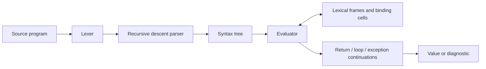

# Java-Subset Interpreter in Racket

[](https://github.com/Des1d3rium/java-subset-interpreter/actions/workflows/test.yml)

A runnable interpreter for a small Java-like teaching language. It evaluates syntax trees with **lexical closures, mutable bindings, recursion, and continuation-based control flow**, including `try` / `catch` / `finally`.

This showcase is based on the [CSDS 345 team project](https://github.com/Des1d3rium/CSDS345-proj) at Case Western Reserve University. It preserves the original history and documents the fixes made while preparing the Part 3 implementation for demonstration.

## Try it

Install the full [Racket 9.3 distribution](https://download.racket-lang.org/), then:

```sh
git clone https://github.com/Des1d3rium/java-subset-interpreter.git
cd java-subset-interpreter
racket interpreter.rkt examples/lexical-scope.java
# 115

racket interpreter.rkt examples/closure-counter.java
# 121

racket interpreter.rkt examples/finally.java
# 45

raco test tests
# 106 tests passed
```

No third-party Racket packages are required. Running `racket interpreter.rkt` without an input path executes the original scope example. Importing `(require "interpreter.rkt")` exposes `(interpret path)` without running a program. Successful CLI runs print the result; failures report to stderr and exit nonzero.

## Three things to explore

| Demo | What it shows | Result |
| --- | --- | --- |
| [Lexical scope](examples/lexical-scope.java) | A called function resolves names in its definition environment, even when the caller shadows them | `115` |
| [Closure counters](examples/closure-counter.java) | Returned functions retain independent mutable bindings after their defining call finishes | `121` |
| [Return and finally](examples/finally.java) | Return values are captured before cleanup, while `finally` observes the latest state | `45` |

For example, the scope demo has global `a = 10` and `b = 20`. `bmethod()` adds global `a` to its own `b = 30`, returning `40`. `cmethod()` adds its own `a = 40` and global `b`, returning `100`. `main()` adds global `a` and its own `b = 5`, producing `115`.

A [short demonstration script](docs/demo.md) walks through the examples and one regression test.

## How it works



Closures capture a chain of frames at definition time. Each frame maps names to shared binding cells, so mutation is visible to the closures that capture that binding without accidentally selecting a caller's same-named variable. Calls create a fresh parameter frame and evaluate arguments from left to right.

Control transfers use continuations. A `try` captures normal completion, `return`, `break`, `continue`, or `throw`, runs `catch` when appropriate, then executes `finally`. A transfer from `finally` supersedes the pending transfer. See [language and design notes](docs/design.md).

## Validation and repairs

The current suite contains **106 checks**: 98 source-program fixtures, the original scope example, a recovery check after failed programs, and 6 CLI checks. It covers expressions, Boolean short-circuiting, scope, escaping closures, recursion, mutation, loops, exceptions, malformed input, runtime diagnostics, and CLI behavior. Each program fixture has a time limit to make nontermination a test failure.

Local validation uses Racket 9.3 CS on macOS ARM64. GitHub Actions runs the same suite on Linux; the badge links to its actual status and logs. This is a correctness suite, not a coverage or performance measurement.

The original scope example returned `130`. The repaired version returns `115`. Other observed repairs include state lost during expression calls, exceptions bypassing caller catch blocks, stale state or skipped cleanup in `finally`, unchecked argument counts, and tokenization of adjacent operators. [Repair notes](docs/repairs.md) link each issue to its regression fixture.

The original Part 3 code is preserved at commit [`5faf614`](https://github.com/Des1d3rium/CSDS345-proj/commit/5faf61446c7fe3203e0c89a653739eb7ce9ff76f). [Recorded baseline results](docs/original-baseline.json) can be reproduced with:

```sh
python3 scripts/check-original.py
```

This optional script runs selected fixtures against the original commit in a temporary directory. It needs Python 3, Git, and Racket; the current correctness suite needs only Racket.

## Language scope

- Integer and Boolean values; variables, assignment expressions, arithmetic and comparisons.
- Blocks, `if` / `else`, `while`, `break`, `continue`, and `return`.
- Functions as values, lexical closures, value parameters, recursion, and mutable captured variables.
- Explicit `throw`, `catch`, and `finally`; line and block comments.

This is a teaching language with Java/C-style syntax. It has no classes, inheritance, arrays, strings, reference parameters, or Java type checker. Integers use Racket's arbitrary-precision arithmetic. Interpreter diagnostics such as undefined variables and division by zero are separate from language-level `throw`. The parser uses mutable lexer state and the library is intended for sequential calls. Part 4 is reserved for a later extension.

## Origin and contributors

Copied from [Des1d3rium/CSDS345-proj](https://github.com/Des1d3rium/CSDS345-proj), specifically [part3](https://github.com/Des1d3rium/CSDS345-proj/tree/part3) at `5faf614`. The course team named in the Part 3 source is **Zeyu Chen, Andrej Antunovikj, and Dasheng Lin**. Original authors remain in the Git history. The showcase revision refactors the evaluator and repairs the parser/lexer, with tests and documentation added in later commits; those changes are distinct from the original course submission.

Dasheng Lin participated across the project's major implementation areas and testing, including expression evaluation, functions and scope, loop control, and exception handling. This was shared team work rather than sole ownership of those modules.

`interpreter2.rkt` is a separate historical file whose header credits **Reed Bower, Haocheng He, and Walter Graham**. It is retained with those credits and is not used by the current evaluator or test command. `simpleParser.rkt` is also retained as a historical parser. The active parser is `functionParser.rkt`, together with `lex.rkt`; original source notices remain in those files. File presence is not a claim that the Part 3 team independently authored every component.
